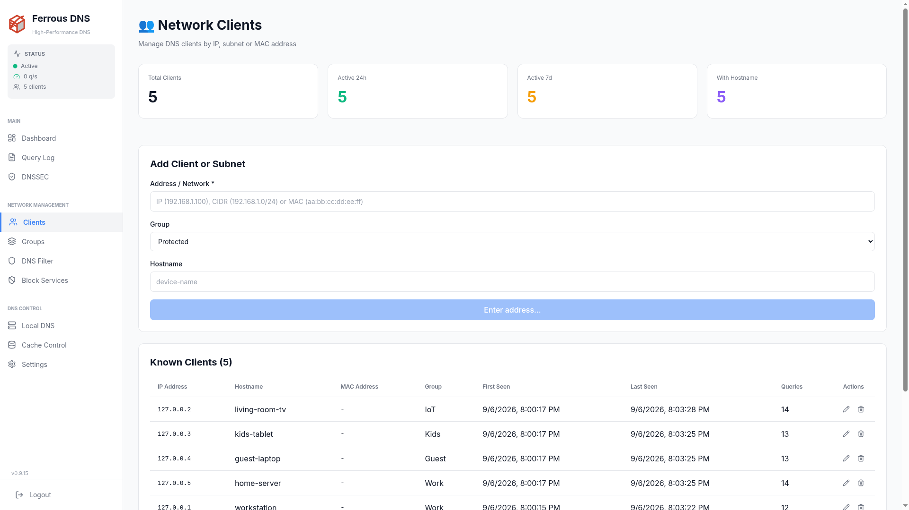
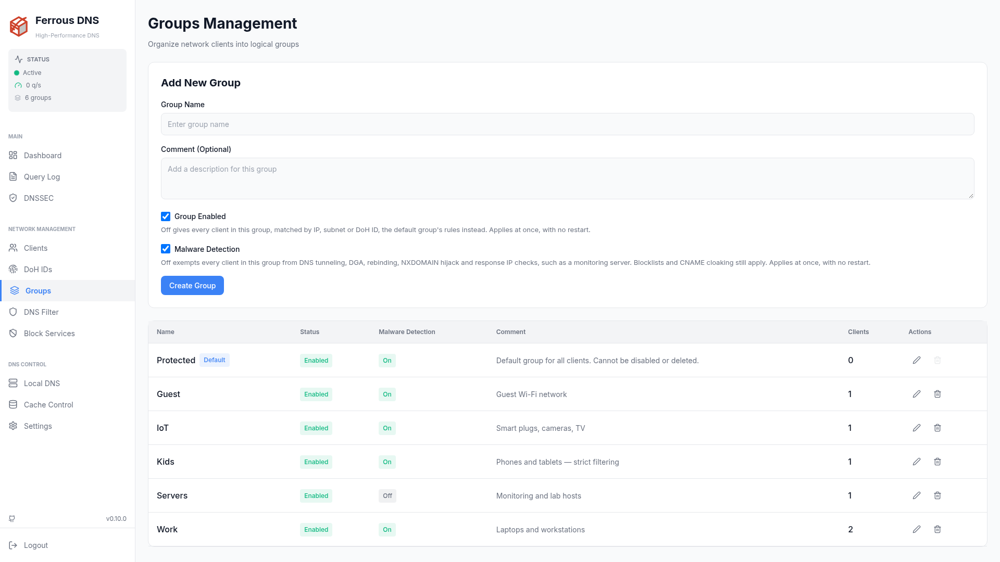

# Client Management

Ferrous DNS automatically detects clients on your network and lets you organize them into groups with independent policies, schedules, and blocking rules.

---

## Client Detection

Ferrous DNS identifies clients by:

- **IP address** — always available
- **MAC address** — available when clients are on the same Layer 2 network (same subnet, no router between client and Ferrous DNS)
- **Hostname** — from three sources, in this order of precedence:
    1. **A name you set** on the **Clients** page or through the API. Nothing automatic replaces it. Names set before this protection existed are treated as automatic: if one is replaced, set it again and it is kept from then on.
    2. **The name the device announces over mDNS/Bonjour**, such as `iPhone-de-Ana` for `iPhone-de-Ana.local`, when `mdns_enabled = true`. Phones, laptops, printers and TVs announce themselves this way, including many that the router's DNS does not name. A device can only name itself: an announcement counts only for the address it was sent from, plus that device's other addresses in the same message. Only clients that query Ferrous DNS are named.
    3. **A PTR lookup** against `local_dns_server`, repeated every hour. It replaces an mDNS name only after the device has gone a day without announcing it, so an address DHCP hands to another device does not keep the old name.

### Configuration

```toml
[dns]
local_dns_server = "192.168.1.1:53"   # router/DHCP server for hostname resolution
mdns_enabled = true                   # also name clients after their mDNS announcements
```

Clients appear in the dashboard under **Clients** as soon as they make a DNS query.

mDNS needs the server on the same network segment as the devices, because multicast does not cross routers. In Docker it needs host networking; see [Installation](../getting-started/installation.md#docker). A change applies after a restart.

---

## Client Groups

Group your clients to apply independent policies:

### Creating a Group

1. Go to **Clients > Groups** in the dashboard
2. Click **New Group**
3. Set a name (e.g. "Kids", "Work", "IoT", "Guest")
4. Assign clients to the group
5. Configure the group's blocklists and schedules

To put one device or a whole range in a group, use **Add Client or Subnet** on the **Clients** page. Enter an IP (`192.168.1.50`) to add a single client with its group, or a CIDR (`192.168.1.0/24`) to add a subnet: every client in the range that has no group of its own then belongs to the subnet's group. A client's own group wins over its subnet's, and a client in neither belongs to **Protected**, the default group.

### Group Policies

Each group can have its own:

| Policy | Description |
|:-------|:------------|
| **Blocklists** | Which blocklists apply to this group |
| **Allowlist** | Domains always allowed for this group; an allow also clears a [malware detection](malware-detection.md#allowlisted-domains) false positive |
| **Malware Detection** | On by default. Off exempts every client in the group from the five [malware detectors](malware-detection.md#exempt-clients), such as a monitoring server; blocklists and CNAME cloaking still apply. Hidden while the master switch in **Settings → Malware Detection** is off |
| **Safe Search** | Force safe search on search engines |
| **Scheduling** | Time-based blocking rules |
| **Conditional forwarding** | Send chosen domains to this group's own upstream pool (split-horizon), cached apart from other groups — see [Conditional Forwarding](../configuration/dns.md#conditional-forwarding) |
| **Upstream** | A different default upstream for every query (planned) |

---

## Parental Controls & Scheduling

Time-based blocking lets you enforce internet policies automatically:

### Example Schedules

**School hours** (block social media during school days):
```text
Monday–Friday, 08:00–15:00 → block Social Media category
```

**Bedtime** (block internet entirely after hours):
```text
Sunday–Thursday, 21:00–07:00 → block all non-essential traffic
Friday–Saturday, 23:00–08:00 → block all non-essential traffic
```

**Work hours** (block entertainment at work devices):
```text
Monday–Friday, 09:00–18:00 → block Gaming, Streaming, Social Media
```

### Setting Up a Schedule

1. Go to **Clients > Groups > [Your Group] > Schedule**
2. Click **Add Schedule Rule**
3. Select days and time range
4. Choose which categories or blocklists to activate during this window
5. Save

The schedule evaluator runs every minute and activates/deactivates blocking rules automatically.

See [Block Services & Schedules](block-services.md) for the complete scheduling guide with REST API examples, days bitmask reference, and real-world scenarios.

---

## Default Group

All clients that are not explicitly assigned to a group use the **Default** group. The default group uses the global blocking settings from `ferrous-dns.toml`.

---

## Disabled Groups

Switching a group's **Enabled** off on the **Groups** page, or sending `"enabled": false` to [`PUT /ferrous/api/v1/groups/{id}`](../api.md#update-group), keeps its clients, subnets and DoH IDs assigned to it. They are handled as clients of the default **Protected** group instead: Protected's blocklists, managed domains, regex filters, blocked services, Safe Search, schedules, Malware Detection switch and pool routes apply to them, and the Query Log records Protected as the group the query was decided in.

- A match goes straight to Protected. A client whose IP is in a disabled group does not fall through to the group of a subnet it is also in.
- Switching the group back on restores its own rules at once, with no restart.
- The default group cannot be disabled.

---

## Client Dashboard

The Clients section of the dashboard shows:

- **Active clients** — last seen within 24 hours
- **Query count** per client (24h / 7d)
- **Block rate** per client
- **Top queried domains** per client
- **Group membership**
- **Last seen** timestamp and hostname



Groups themselves are managed one level up, under **Groups**:



---

## DoH IDs

The **DoH IDs** page (and [`/ferrous/api/v1/doh-ids`](../api.md#doh-ids)) maintains a registry of per-device DNS-over-HTTPS identifiers mapped to client groups, separate from the IP-based **Clients** inventory:

- **Name** — a unique display name (up to 100 characters), such as `Alice's iPhone` or `Work Laptop`
- **Client ID** — a random UUID v4 generated by default, or a readable identifier of 1–63 lowercase ASCII characters (`a-z`, `0-9`, `-`, not starting or ending with `-`)
- **Group** — the client group whose policies apply to the entry (a group with assigned DoH IDs cannot be deleted until they are reassigned or removed)
- **Comment** — optional note (up to 500 characters)

### Routing and Group Precedence (`/dns-query/<ClientID>`)

When a DoH client queries `/dns-query/<ClientID>`:

1. **Format validation** — the `<ClientID>` path segment must match the format rules above (`1–63` characters of `a-z`, `0-9`, `-`, no leading/trailing `-`); malformed identifiers are rejected with `400 Bad Request`.
2. **Registration policy (`doh_allow_unregistered_ids`)**:
   - **Strict mode (default, `false`)** — only registered Client IDs are accepted; unknown IDs receive `400 Bad Request`.
   - **Permissive mode (`true`)** — valid unregistered Client IDs are accepted, attributed in the Query Log and Dashboard under `<ClientID>`, and inherit the client IP's group rules. This can be toggled live on the **DoH IDs** page (**Allow Unregistered Client IDs**) or set via `[server.encrypted_dns] doh_allow_unregistered_ids = true` in `ferrous-dns.toml`.
3. **Group resolution order** — a registered DoH ID's assigned group takes highest priority, followed by the connecting IP's explicit client assignment, then matching CIDR subnet rules, and finally the default **Protected** group (`DoH ID → IP → Subnet → Protected`). A match whose group is [disabled](#disabled-groups) resolves to **Protected**.
4. **Query Log & Dashboard attribution** — DoH queries carrying a `<ClientID>` record both the connecting IP and `doh_client_id`, display the registered DoH ID's **Name** (or the raw `<ClientID>` when unregistered) in the Query Log and Top Clients views, and do not create synthetic entries in the IP-based **Clients** table (so the IP-based **Active clients** count reflects only IP-tracked clients, while **Top Clients** includes DoH IDs).

---

## PROXY Protocol v2

When Ferrous DNS runs behind a load balancer (HAProxy, nginx, AWS NLB), the real client IP is hidden. Enable PROXY Protocol v2 to restore accurate client detection:

```toml
[server]
proxy_protocol_enabled = true
```

See [Security](security.md#proxy-protocol) for details.
